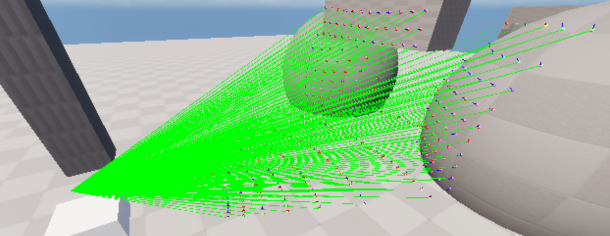
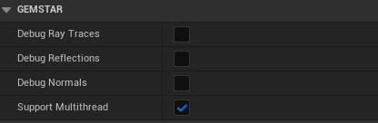
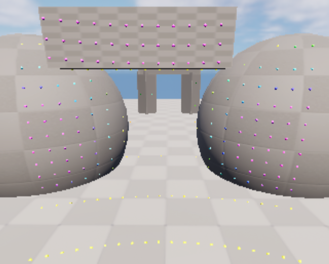

# GEMSTAR UE_Lidar_Feature

[](https://www.dlr.de/en/ts/about-us/the-institute-of-transportation-systems)

The `ue_lidar_feature` provides a ray-casting-based LiDAR sensor for GEMSTAR in Unreal Engine.
The sensor performs geometric ray casting in the Unreal scene and generates LiDAR reflections as a `SensorView` in OSI.

The feature also supports an optional weather-based degradation of LiDAR performance, using environmental information provided by [ue_weather_effect_feature](https://github.com/DLR-TS/ue_weather_effect_feature#readme) via GEMSTAR `WEATHERDATA` interface.



## Input
- Weather Data (Please see the [Configuration](#configuration)).

## Output
- OSI Sensor View
- Local GEMSTAR dataflows for logging and visualization

## Weather-dependent LiDAR degradation
The `LidarWeatherEffectModel` provides an optional phenomenological weather degradation model for LiDAR reflections.

The algorithem is based on the **vanishing distance approach** and **measurement-derived parameters** described in [ROADVIEW](https://roadview-project.eu/deliverables/) **D3.3 - Library of validated statistical noise models**.

 Separate sets of parameters are provided for `Fog` , `Rain`, and `Snow`. The current implementation therefore applies only one adverse weather condition at a time:
- `Clear` - no weather dependent degradation
- `Fog` - Fog vanishing distance model
- `Rain` - Rain vanishing distance model
- `Snow` - Snow vanishing distance model

The weather degradation model processes LiDAR points individually and calculates a weather-dependent vanishing distance to determine whether a reflection is retained or removed.

`ROADVIEW` defines the vanishing-distance relation as:
```text
VanishingDistance = VanishingSlope * MOR
```
Where `MOR` is **Meteorological Optical Range** in meters and represents the visibilty range under the respective weather condtion.

In GEMSTAR the relation is generalized to:
```text
VanishingDistance = VanishingSlope * VisualRange * LidarCoefficient
```
For Fog `VisualRange` corresponding directly to `MOR`. For Rain and Snow, an equivalent visual range is derived from the Precipitation intensity.
`LidarCoefficient` is an optional correction factor. A default value `LidarCoefficient = 1.0` applies no addtional scaling.

**vanishing Slope** depends on the weather condtion and LiDAR point reflectivity:

| Weather | Reflectivity < 10 | Reflectivity >= 10  |
|----------|----------|----------|
| Fog | `0.30286536` | `0.34634364` |
| Rain | `0.15688675` | `0.22530445` |
| Snow | `0.32685039` | `0.32685039` |

The ROADVIEW D3.3 derives two reflectivity classes from the measured LiDAR data, separated at reflectivity value of `10`:
```text
Reflectivity < 10 -> Low reflectivity slope
Reflectivity >= 10 -> High reflectivity slope
```

# Getting started

First clone the GEMSTAR Interfaces plugin inside the Plugins directory and the UE_Osivisualizer_Feature inside Plugins/GameFeatures.

Add the plugin to your Unreal project:
```sh
mkdir Plugins/GameFeatures
cd Plugins/GameFeatures

git clone https://github.com/DLR-TS/ue_lidar_feature.git
```
or:
```sh
git submodule add https://github.com/DLR-TS/ue_lidar_feature.git
```

# Configuration



The following debug options can be used to inspect the geomitrical LiDAR simulation:

**Debug Ray Traces** Show debug lines\
**Debug Reflections** Show collision points\
**Debug Normals** show normal vectors of mesh at collision point

Configure the sensor in the GEMSTAR scenario `INI` using section named `[ue_lidar_feature:sensor1]`:

```ini
[ue_lidar_feature:sensor1]
;Debug=true
Mount=SensorPlatform_1
MountingPositionX=260
MountingPositionY=0
MountingPositionZ=70
MountingOrientationRoll=0
MountingOrientationPitch=0
MountingOrientationYaw=0
FoVHorizontal=90
FoVVertical=20
NumberOfRaysHorizontal=251
NumberOfRaysVertical=21
;simulated view distance in m
Range=100
;NoFalloff is reflection shall be 100%
NoFalloff=true
;DistanceHalfFalloff for simple model: check?
DistanceHalfFalloff=60
;Optional weather degradation
WeatherInput=[ue_weather_effect_feature]
```

The following weather-related parameters are relevant to activate **weather degradation model** for LiDAR reflections:

First be sure that the sensor uses `ue_weather_effect_feature` as an input:
```ini
[ue_lidar_feature:sensor1]
;...
;Optional weather degradation
WeatherInput=[ue_weather_effect_feature]
```

Then define the weather model according to the [ue_weather_effect_feature](https://github.com/DLR-TS/ue_weather_effect_feature#readme):
 ```ini
[ue_weather_effect_feature]
;Enable or disable behavior/ effect
WeatherEffectEnabled=true
;Explisit weather degradation model: Clear, Fog, Rain, Snow
ActiveWeatherType=Fog
;Meteorological Optical Range in meters for fog condtion
MOR=15.0
;LiDAR weather-model parameters 
LidarCoefficient=1.0
ReflectivityThreshold=10.0
```

You can find more configuration examples in [Config folder](Config).

# Test



A test map is provided with a moving object that moves through a course of different objects.
Open in Unreal editor `/ue_lidar_feature/Test/LidarTestMap` and press Play. The test map also contains the manager for the pointcloud visualization to show the impact of the intensity model.

---------------
**Contact:** opensource-ts@dlr.de

This project uses the Open Simulation Interface ([OSI](https://github.com/OpenSimulationInterface/open-simulation-interface)), which is licensed under the
Mozilla Public License 2.0.

Inspired by: [MetaLidar](https://github.com/metabotics-ai/MetaLidar)